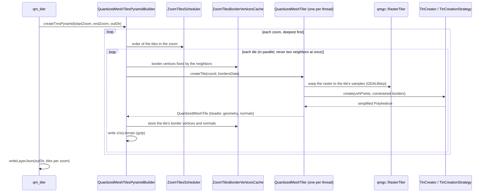
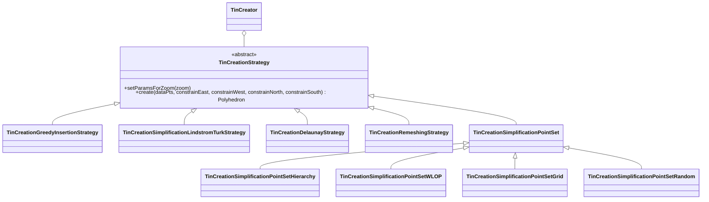

# Architecture

This page gives an overview of the code, for those who want to modify or extend it. The classes and functions are
documented in detail in the [API reference](api-reference.md).

## Repository layout

```text
emodnet_qmgc/
├── src/
│   ├── apps/            # qm_tiler and dem2tin (command line parsing, setup)
│   ├── base/            # quantized-mesh format, tiler, pyramid builder, schedulers, layer.json
│   │   └── tiling/      # TMS global geodetic grid and raster sampling (formerly libctb)
│   ├── tin_creation/    # TIN creation strategies
│   ├── cgal/            # CGAL extensions: constrained placements, feature detection, mesh builders
│   └── dev-tests/       # developer tools (see Developer tools)
├── scripts/             # simple_tiles_server.py, create_layer_file.py
├── 3rdParty/            # bundled meshoptimizer (modified) and nlohmann/json
├── cmake/modules/       # Find*.cmake modules
├── docs/                # this documentation (MkDocs) and logos
├── matlab/              # loadStats.m, to load the output of compute_statistics
├── mkdocs.yml           # documentation site configuration
├── doxyfile.cfg         # Doxygen configuration (API reference)
└── Dockerfile
```

## Processing pipeline



## Main components

### Tiling (`src/base/tiling`)

- **`qmgc::GlobalGeodeticGrid`**: the TMS global geodetic (EPSG:4326) grid, with two tiles at zoom 0. Converts between
  zooms, resolutions, tile coordinates and geographic extents.
- **`qmgc::RasterTiler`**: extracts the samples of the source raster covered by a tile, through `GDALWarp()`. GDAL
  takes care of reprojection, overviews and nodata. Its behavior is configured with `qmgc::TilerOptions` (sampling
  mode, resampling algorithm, overviews...).
- `geo_types.h`: `TilePoint`, `TileCoordinate`, `TileBounds`, `CRSPoint`, `CRSBounds`.

These classes are derived from [cesium-terrain-builder](https://github.com/geo-data/cesium-terrain-builder), which the
project no longer depends on since v0.3.

### Tiles and pyramid (`src/base`)

- **`QuantizedMeshTiler`**: creates a single tile. It samples the raster, applies the [height
  transformations](../user-guide/general-parameters.md#interpreting-the-raster), normalizes the samples to u/v/h
  coordinates in `[0, 1]`, runs the TIN creation, and fills the quantized-mesh header, geometry and normals.
- **`QuantizedMeshTilesPyramidBuilder`**: builds all the tiles of a range of zooms, with one `QuantizedMeshTiler` per
  thread. It uses the scheduler and the border vertices cache to keep neighboring tiles consistent.
- **`ZoomTilesScheduler`** and its strategies (`rowwise`, `columnwise`, `chessboard`, `4connected`): the preferred
  order of the tiles within a zoom.
- **`ZoomTilesBorderVerticesCache`**: stores the border vertices (and their normals) of the tiles already built, and
  provides them, as `BordersData`, to the neighbors still to be built.
- **`QuantizedMesh`** / **`QuantizedMeshTile`**: reading and writing the
  [quantized-mesh-1.0](https://github.com/CesiumGS/quantized-mesh) format, including the oct-encoded normals and
  water mask extensions. The vertices and indices are optimized with meshoptimizer, as required for high-watermark
  encoding.
- `layer_json.h`: writes or merges `layer.json`.
- `GZipFileWriter` / `GZipFileReader`: gzip-compressed I/O of the tiles.

### TIN creation (`src/tin_creation`)

The TIN creation follows the **strategy pattern**. `TinCreator` holds a `TinCreationStrategy`, which every method
implements:



- `setParamsForZoom()` selects the parameters for the zoom being built, usually through
  `standardHandlingOfThresholdPerZoom()` (in `tin_creation_utils.h`), which implements the
  [per-zoom rules](../user-guide/parameters-per-zoom.md).
- `create()` receives the samples, and flags telling which borders are constrained by neighbors already built.
- `TinCreationRemeshingStrategy` exists but is disabled in the apps, as it is experimental.

### Adding a new TIN creation method

1. Create a class derived from `TinCreationStrategy` (or `TinCreationSimplificationPointSet`, for a point set method
   that reuses the border and sharp-edge handling).
2. Implement `setParamsForZoom()` and `create()`. The vertices on the constrained borders must be kept unchanged.
3. Add the source files to `src/tin_creation/CMakeLists.txt`.
4. In `src/apps/qm_tiler.cpp` (and `dem2tin.cpp`), add its options, prefixed with `tc-<name>-`, and a branch that
   creates it for the `--tc-strategy` value.
5. Document it in the [user guide](../user-guide/tin-creation/index.md).

### CGAL extensions (`src/cgal`)

Helpers built on CGAL, used by the TIN creation strategies: placement and cost policies for the edge collapse that keep
the tile borders in place (`further_constrained_placement.h`, `avoid_vertical_walls_placement.h`), sharp-edge
detection and polyline extraction for the point set methods, and builders that turn projected triangulations into
`Polyhedron`s.
