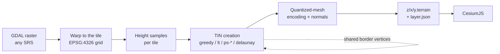

# EMODnet Quantized Mesh Generator for Cesium

**emodnet_qmgc** creates terrain tiles in Cesium's
[quantized-mesh](https://github.com/CesiumGS/quantized-mesh) format from any raster that
[GDAL](https://gdal.org) can read. You can stream the tiles straight into a
[CesiumJS](https://cesium.com/platform/cesiumjs/) virtual globe.

Each tile is a *Triangulated Irregular Network* (TIN). Instead of storing a regular grid of heights, every tile stores a
triangle mesh adapted to the relief: many triangles where the terrain is rough, and few where it is flat. The project
offers several TIN creation algorithms. Each tile's mesh is simplified on its own, and **its borders always match its
neighbors'**, so the terrain has no cracks.

The code was developed to publish the European seabed bathymetry built by the
[EMODnet Bathymetry](https://emodnet.ec.europa.eu/en/bathymetry) project in its 3D viewer. It works with any
elevation or depth model.

-   :material-download: **[Installation](getting-started/installation.md)**

    Build from source on Ubuntu, or use the Docker image.

-   :material-rocket-launch: **[Quick start](getting-started/quickstart.md)**

    Go from a raster to tiles in Cesium in four commands.

-   :material-school: **[Tutorial](getting-started/tutorial.md)**

    Work through a complete example with EMODnet bathymetry data.

-   :material-tune: **[User guide](user-guide/qm_tiler.md)**

    See every `qm_tiler` option, and the TIN creation methods.

## Features

- **Any GDAL raster, in any spatial reference system:** GeoTIFF, ESRI ASCII grid, NetCDF, a VRT mosaic of many
  files, and so on. The raster is warped to the global geodetic (EPSG:4326) TMS grid on the fly.
- **Several TIN creation strategies:** greedy insertion (the default), Lindstrom-Turk edge collapse, four point set
  simplification methods, and a plain Delaunay triangulation of the raster samples.
- **Crack-free borders:** the vertices on a border shared by two tiles are passed from the first tile built to its
  neighbors, also when tiles are built in parallel.
- **Parameters per zoom level:** set a value for the root of the pyramid and let it scale with depth, or give one value
  per zoom.
- **Lighting ready:** tiles include seamless oct-encoded per-vertex normals (the `octvertexnormals` extension).
- **Ready for Cesium:** `qm_tiler` writes the `layer.json` that describes the tileset, and a pyramid can be built in
  several runs.
- **Bathymetry helpers:** read depths as heights, clip values, and exaggerate the relief above and below sea level
  separately.

## How it works

The pyramid is built **from the bottom up**: from the deepest zoom level (the highest resolution) up to zoom 0. The
tiles within a zoom can be processed in parallel.

## Project and acknowledgements

This project has been developed by [Coronis Computing S.L.](https://www.coronis.es) within the
[EMODnet Bathymetry](https://emodnet.ec.europa.eu/en/bathymetry) project, part of the European Marine Observation
and Data Network ([EMODnet](https://emodnet.ec.europa.eu/)).

[{ .qmgc-partners__emodnet }](https://emodnet.ec.europa.eu/en/bathymetry)

The source code is available on [GitHub](https://github.com/coronis-computing/emodnet_qmgc) under the
[GNU General Public License v3](https://github.com/coronis-computing/emodnet_qmgc/blob/master/LICENSE.txt).
