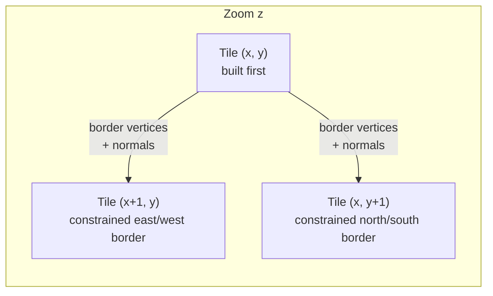

# Tile processing & threads

The mesh of each tile is created independently, so the tiles within a zoom can be built in parallel. However, if
each tile were simplified without looking at its neighbors, the vertices on their shared borders would not match, and
the terrain would show **cracks** between tiles.

To avoid this, `qm_tiler` keeps track of the tiles already built. When a tile is finished, the vertices it kept on
its borders are stored, together with their normals. When a neighboring tile is built afterwards, it is forced to use
exactly the same vertices on the shared border. Within a zoom, the tiles thus form a continuous surface.



!!! note
    The `delaunay` strategy keeps all the samples of the raster, so the borders of neighboring tiles always match,
    and no border constraints are needed. Its tiles are built fully independently.

## Options

`--num-threads` (default: `0`)
:   The maximum number of tiles built at the same time. `0` uses as many threads as there are CPU cores.

`--scheduler` (default: `rowwise`)
:   The **preferred** order in which the tiles of a zoom are processed:

    | Value | Order |
    |-------|-------|
    | `rowwise` | Tiles are processed row by row in the grid of the zoom. |
    | `columnwise` | Tiles are processed column by column in the grid of the zoom. |
    | `chessboard` | Taking the tiles in row-wise order, the odd tiles are processed before the even ones, like the squares of a chessboard. |
    | `4connected` | Starts with the central tile, and visits the rest through their 4-connected neighbors. |

## How the threads are scheduled

Two neighboring tiles cannot be built at the same time, since the second one needs the borders of the first.
`qm_tiler` therefore tracks the tiles being processed, and only starts a tile when none of its 8 neighbors is being
processed. It follows the order of the scheduler, but starts tiles as soon as possible, to keep up to
`--num-threads` tiles busy. A tile that comes later in the scheduler's order may therefore start before an earlier
one, if the earlier one has a neighbor still being processed.

!!! warning "Multithreading changes the results"
    The shape of a tile's border depends on whether it was built before or after its neighbor. With several threads,
    the order also depends on how long each tile takes to build, so **the results are not deterministic**: two runs
    with the same parameters may give slightly different tiles. The quality of the approximation is the same, but the
    meshes differ.

    For reproducible results, for example when comparing parameters, use `--num-threads 1`.

## Memory and very large rasters

Each thread opens its own handle to the input raster and works on one tile at a time, so the memory used grows with
the number of threads, not with the size of the raster.

The tiles at low zoom levels cover large parts of the raster, which then has to be resampled. The raster is warped
through GDAL, which uses the **overviews** of the dataset automatically when available. For large DEMs, build them
beforehand:

```bash
gdaladdo -r average my_dem.tif
```
